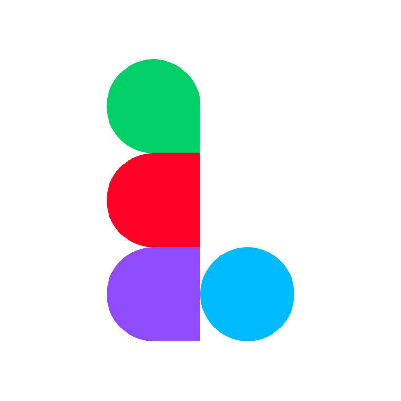

# Ligma

Created in [T3 Code](https://t3.codes).

Lightweight desktop app for [Figma](https://www.figma.com), built with [Tauri 2](https://tauri.app). It opens `figma.com` in the system webview (WKWebView on macOS, WebView2 on Windows). No bundled browser engine, so the app is about 4 MB.

## Download

Get the latest macOS and Windows builds from [Releases](../../releases/latest). Both are unsigned; the release notes explain how to open them.

Ligma updates itself. On launch and every 6 hours it checks the latest release, downloads a newer version in the background and offers to restart. Choose Later and it installs when you quit. The app is replaced in place, so you stay signed in. If an update can't be installed, Ligma says why and offers to download it or report it.

To report a problem, use Report… in Settings (or Help > Report a Problem… on macOS). It opens a GitHub issue filled in with Ligma's version, the system and the end of `ligma.log`, for you to check and submit. The log is in `%LOCALAPPDATA%\dev.ligma.client\logs` on Windows and `~/Library/Logs/dev.ligma.client` on macOS.

To publish a release, bump `version` in `src-tauri/tauri.conf.json`, add a `## <version> - <date>` section with its changes to [`CHANGELOG.md`](CHANGELOG.md), then push a matching tag (`git tag v0.6.0 && git push --tags`). `.github/workflows/release.yml` stops if the changelog section is missing or the tag doesn't match the version. It writes the release notes from the changelog section with `scripts/release-notes.mjs` (run it locally to preview), builds both platforms, attaches the installers and writes the `latest.json` that installed apps check. It signs the update packages with the `TAURI_SIGNING_PRIVATE_KEY` repository secret (a key from `npx tauri signer generate`, without password), whose public key is `plugins.updater.pubkey` in `tauri.conf.json`. Keep the private key: without it, installed apps can't update. If Rust dependencies changed, run `npm run notices` first (needs `cargo install --locked cargo-about --features cli`) to refresh [`THIRD_PARTY_NOTICES.md`](THIRD_PARTY_NOTICES.md), which ships in the installers.

## Requirements

- [Rust](https://rustup.rs) (stable)
- Node.js (only for the Tauri CLI)

## Run

```sh
npm install
npm run dev     # debug build, opens the app
npm run build   # release bundle in src-tauri/target/release/bundle/
```

Regenerate icons after editing `assets/icon.png` (macOS) or `assets/icon-windows.png` (Windows `icon.ico`):

```sh
npm run icon
```

## Behavior

- Tabs like the Figma desktop app, in place of the native title bar (on Windows the tab bar draws its own minimize, maximize and close buttons). Home (`https://www.figma.com/files`) is pinned on the left. Files opened from Home get their own tab, or focus the tab already showing them.
- Right-click a tab to pin or unpin it, copy its link, open it in the browser, reload it, or close it, the other tabs or all tabs. Pinned tabs sit after Home and show only their icon. Home's menu has Copy Link, Reload and Close Other Tabs.
- A file whose name starts with an emoji shows that emoji as its tab icon.
- With `"restoreTabs": true` (Settings > Reopen tabs from last time), Ligma reopens your tabs, pins and the tab you had open. They're kept in `session.json` next to `settings.json`. Only the tab you had open loads; the others load when selected.
- Shortcuts (macOS): `Cmd+T` new tab, `Cmd+W` close tab, `Ctrl+Tab` / `Ctrl+Shift+Tab` switch tabs. Middle-click also closes a tab.
- Links inside `figma.com` stay in the app. All other web links open in the default browser.
- Continue with Google signs in the way the Figma desktop app does, because Google doesn't allow sign-in inside embedded webviews: you approve Ligma on Figma's own page, signed in to Figma in a real browser, and Figma hands the sign-in back through a `figma://app_auth/redeem` link to the page you started from, which completes it. Figma only sends that link to `figma://`, whichever app asked (see `src-tauri/src/auth.rs`). Add account in Figma's account menu opens Figma's sign-in page in a new tab, and Continue with Google there works the same way, then switches that tab to the added account.
  - macOS: the approval page opens in Apple's sign-in sheet, which shares Safari's cookies and catches the `figma://` link itself, so it works alongside the Figma desktop app (`web_auth.rs`).
  - Windows: the page opens in your browser. Without the Figma desktop app, Ligma registers itself for `figma://` and also opens Figma's "Open in desktop app" links in a tab. With it, Ligma borrows `figma://` only while a sign-in waits (up to 15 minutes) and then puts Figma's entry back, also at the next launch if Ligma quit in between (`figma_scheme.rs`). A second Ligma started by a link passes it on and exits.
  - A sign-in link is only accepted while a sign-in Ligma started is waiting, so a link from anywhere else can't sign you into another account.
- Window size and position are saved between launches.
- Drag-and-drop goes to Figma, so you can drop images and files onto the canvas.
- On macOS, the app sends a Safari user agent so Figma treats the webview as a supported browser.
- Local fonts: Figma loads installed fonts through its font helper, `FigmaAgent`. If the helper isn't running, Ligma starts it (from `~/Library/Application Support/Figma/FigmaAgent.app` on macOS, `%LOCALAPPDATA%/FigmaAgent/figma_agent.exe` on Windows) and stops it on quit. The helper is installed by the Figma desktop app or [Figma's font installer](https://www.figma.com/downloads/). On Windows, Figma also waits for the browser's Local Network Access permission, which WebView2 reports as "prompt" but never asks for, so Ligma reports it as granted to Figma tabs.
- Background tabs give memory back (see [Memory](#memory)).
- Discord Rich Presence shows "Ligma" with the open file ("Editing …"), where you are in it and the selected tool. Under the file's name it shows the page's name in Figma Design and FigJam, the slide in Figma Slides and while presenting ("Slide 3 of 12", or "Frame 3 of 40" in a prototype), the chat's name in Figma Make, which asset you're on in Figma Buzz ("Asset 2 of 5") and the webpage's name in Figma Sites. The tool's icon (an art asset of the Discord application, see `scripts/discord-assets.mjs`) is the small image, named when hovered: blue while Ligma has focus, grey when you switch away. Settings can hide the file name (it then says "Editing a file", and where you are is hidden with it), the tool, or where you are for each product, or turn it off; in `settings.json` these are `"discordShowFile"`, `"discordShowTool"`, `"discordShowPage"`, `"discordShowFigjamPage"`, `"discordShowSlide"`, `"discordShowChat"`, `"discordShowAsset"`, `"discordShowWebpage"` and `"discordRichPresence"` (see [Memory](#memory) for where it lives).
- Invites to files (off by default) makes the open file a Discord party, sized by the people Figma shows in it. Friends can be invited from the + menu in a Discord chat, or ask to join from your profile, which Ligma asks you about. Joining opens the file in their Ligma, starting it if needed, and Figma shows it to them if they have access. It needs Rich Presence on for both of you; in `settings.json` it's `"discordInvites"`.
- Settings (macOS: Ligma > Settings…, `Cmd+,`; Windows: the gear next to minimize) holds the options from `settings.json`, one page per category: Appearance, Tabs & Memory, Discord, Plugins and About. Changes are saved and apply right away.
- Development plugins, like the Figma desktop app's Plugins > Development > Import plugin from manifest…, which figma.com doesn't have. Settings > Plugins imports a plugin's `manifest.json` (built: `main` has to be JavaScript), switches it on or off, shows its folder or removes it; the list is `plugins.json` next to `settings.json`. Plugins that are on show in Figma's Actions panel under Plugins & widgets, as in the desktop app: marked Development, with their menu commands, Remove in their … menu, and a Development filter that lists only them with Import from manifest…. They show in the files whose editor they're made for (Design, FigJam, Slides or Buzz). Its files are read on every run, so a rebuilt plugin runs its new code. Ligma runs the code against the plugin API Figma's web editor offers on the page (`window.figma`, as in the developer console), so it needs a file you can edit, and `figma.showUI`, messages with the UI, `figma.command`, the `run` and `close` events and `closePlugin` work as in the app. Unlike there, plugins aren't sandboxed: they run with the page's access, so import only ones you trust. `figma.clientStorage` is kept per plugin in figma.com's IndexedDB. Widgets, plugin parameters (quick actions) and the manifest's `build` command aren't supported (see `src-tauri/src/plugins.rs`).
- Interface scale (Settings > Appearance, `"interfaceScale"` in percent, 50 to 200) zooms Figma tabs, the tab bar, the tab menu, prompts and the settings window together, like a browser's zoom; − and + step through the usual zoom levels. The tab bar grows with it.
- The tab menu, prompts (update ready, join requests, errors) and the settings window are drawn by Ligma in Figma's style and follow the editor's light or dark theme. On Windows 11 they have no accent-colored border, just the system shadow.
- Figma pages have no access to Tauri IPC. Only the local tab bar has permissions (`src-tauri/capabilities/tab-bar.json`).

## Memory

Ligma itself uses a few MB. Nearly all of its memory is Figma: every loaded file keeps its whole editor (WASM engine, canvas, document) in a WebView2/WKWebView renderer, hundreds of MB to several GB each. So Ligma winds down tabs you aren't looking at:

- On hide (Windows): WebView2 is asked to trim the tab's memory (`MemoryUsageTargetLevel` low). The page keeps running.
- After 5 minutes hidden: the page is frozen and resumes when you switch back. Figma reconnects to its servers. On Windows that's `TrySuspend`, which also trims memory. On macOS it's WebKit's private `_suspendPage:`, which saves CPU but not memory.
- Optionally, only a few hidden tabs stay loaded (all platforms, `maxHiddenTabsLoaded`): past that, switching away from a tab puts the oldest hidden one to sleep right away. Home, which reloads quickly, always goes first.
- After 30 minutes hidden (all platforms): the tab goes to sleep. Its webview is closed, the tab is dimmed, and it reloads when selected. With `reloadSnapshots` on macOS, a file tab shows its last image, with a soft shimmer passing over it, until Figma has drawn the file again (up to 20 seconds).
- While macOS is short of memory: tabs go to sleep sooner, after 10 minutes hidden when macOS warns of memory pressure and at once when pressure is critical. WKWebView has no way to trim a page, so sleeping is the only step that frees a hidden file's memory on macOS. WebKit already slows timers in hidden tabs on its own.

Freezing and sleeping are skipped while you're offline or while Figma's `beforeunload` handler says leaving would lose edits. Set the sleep timeout and how many hidden tabs stay loaded, or turn sleeping off with `0`, in `settings.json`, created on first launch in `%APPDATA%\dev.ligma.client` (Windows) or `~/Library/Application Support/dev.ligma.client` (macOS):

```json
{ "sleepTabsAfterMinutes": 30, "maxHiddenTabsLoaded": null, "reloadSnapshots": false }
```

The Settings window changes these without a restart. After editing the file by hand, restart Ligma. `"maxHiddenTabsLoaded": null` (the default) sets no limit; `1` keeps only the last tab you left loaded and `0` only the one you're looking at, trading reloads for memory. `"reloadSnapshots": true` turns on the snapshots. With `"sleepTabsAfterMinutes": 0` every tab stays loaded, whatever the limit or memory pressure. To see memory use on Windows, summed over Ligma and its WebView2 processes:

```powershell
./scripts/measure-memory.ps1               # Ligma
./scripts/measure-memory.ps1 -Name Figma   # Figma desktop, to compare
```

On macOS, summed over Ligma and the WebKit processes it's responsible for (as Activity Monitor attributes them):

```sh
./scripts/measure-memory.sh                # Ligma
./scripts/measure-memory.sh -n Figma       # Figma desktop, to compare
./scripts/measure-memory.sh -p 1234 -w 5   # one instance by PID, every 5 seconds
```

## Known limits

- Windows builds are produced by CI and haven't been tested on a real Windows machine yet. Keyboard tab shortcuts are macOS-only for now.

## Legal

Ligma is [MIT licensed](LICENSE). It's not affiliated with Figma or Discord.

[Terms of Service](TERMS.md) · [Privacy Policy](PRIVACY.md) · [Security](SECURITY.md) · [Third-party notices](THIRD_PARTY_NOTICES.md)
